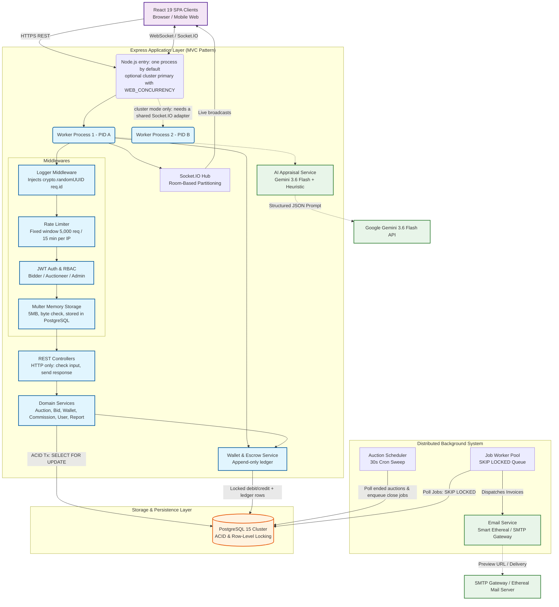
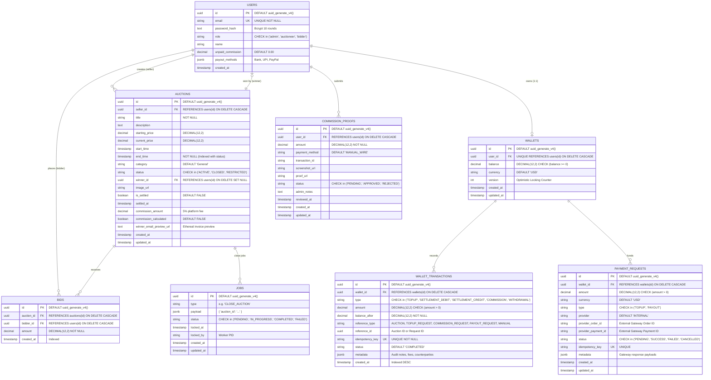
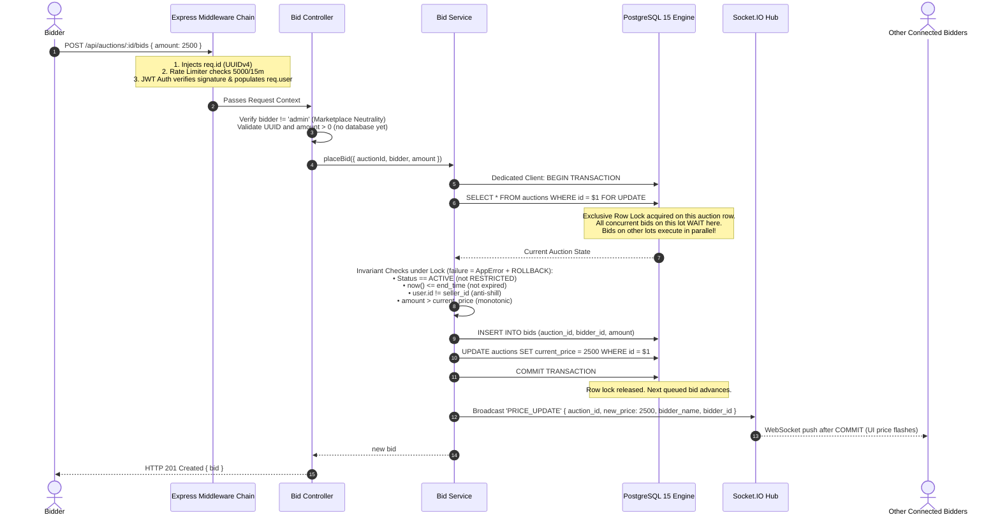
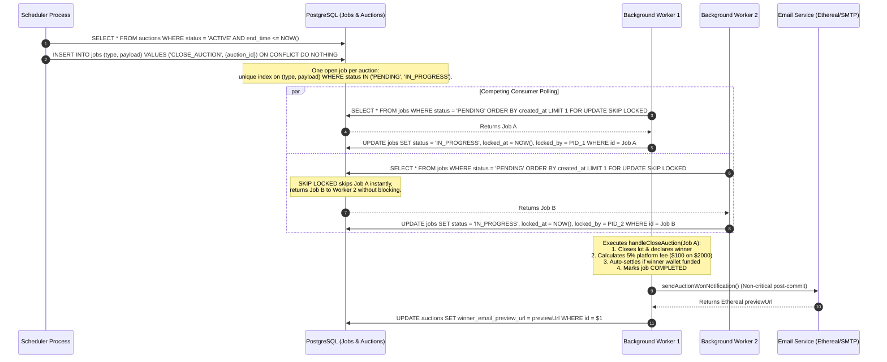
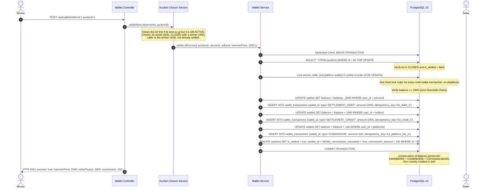
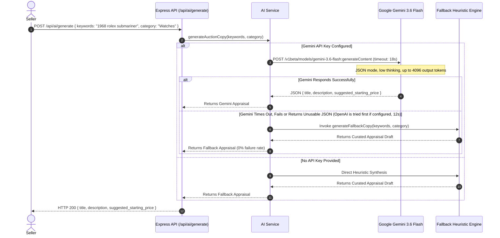

# AuctionLoom: Detailed High-Level (HLD) & Low-Level Design (LLD)
## The Definitive Systems Architecture Specification

---

## 1. System Overview & Executive Summary

**AuctionLoom** is a real-time auction and settlement platform built to stay correct under heavy write contention at the end of an auction: bids on one lot are serialized, money can't be spent twice, and ended auctions are closed in the background.

### Core Architectural Pillars
1. **Pessimistic Row-Level Locking (`SELECT FOR UPDATE`)**: Eliminates race conditions and "Thundering Herd" retry storms during the closing seconds of high-value auctions.
2. **Append-Only Wallet Ledger**: Zero-overdraft invariant (`CHECK (balance >= 0)`), a ledger row with `balance_after` for every change, and settlements whose entries sum to zero (buyer -P, seller +0.95P, platform +0.05P). Top-ups and withdrawals are simulated, so they have no counter-entry in an external account.
3. **PostgreSQL Job Queue (`SKIP LOCKED`)**: A scheduler polls for ended auctions and queues close jobs; competing workers claim them with `FOR UPDATE SKIP LOCKED`. (This is a polling job queue, not a transactional outbox: the job is not written in the same transaction as the business change. Closing is idempotent, and the in-process sweep also closes ended auctions, so a missed job only delays closing.)
4. **Resilient AI Luxury Appraisal**: Integrates **Google Gemini 3.6 Flash** in JSON mode (the server checks every field before using it), with OpenAI as an optional second choice and a built-in template as the last resort, so the endpoint always returns a draft.
5. **Optional Cluster Mode**: `WEB_CONCURRENCY` > 1 forks Node.js cluster workers and restarts any that crash. Socket.IO rooms are per process, so this needs a shared adapter (e.g. Redis, not included); the live demo runs one process.

---

## 2. System Requirements

### 2.1 Functional Requirements
- **Real-Time Bidding**: Bidders can place bids on active lots. Bids must be strictly monotonic (greater than `current_price`), non-seller (anti-shill), and rejected if the lot is restricted or expired.
- **Live Price Updates**: All connected bidders in an auction room receive the new price via a WebSocket broadcast right after the transaction commits (latency is network-bound; not a measured guarantee).
- **Asynchronous Lot Concurrency & Closure**: Lots automatically transition from `ACTIVE` to `CLOSED` upon expiration. The highest bidder is declared winner, and a 5% platform fee is calculated.
- **1-Click Atomic Escrow Settlement**: The winning bidder settles the hammer price from their wallet. The seller is credited 95%, and the platform treasury receives 5% commission in a single atomic database transaction.
- **Autonomous Top-Up & Payout Gateway Abstraction**: Gateway-agnostic payment requests supporting instant internal funding and future Razorpay/Stripe webhooks.
- **AI Luxury Appraisal**: Sellers can auto-generate luxury auction titles, historical descriptions, and suggested opening bids by providing product keywords and categories.
- **Administrative Governance**: Admins can inspect platform revenue metrics, review manual wire transfer commission proofs, and apply immediate restriction freezes on suspect lots.

### 2.2 Non-Functional Requirements: What Holds and What Was Measured

| Metric | What holds / what was measured | Mechanism |
| :--- | :--- | :--- |
| **Bid latency** | A single bid takes a few milliseconds of database time. With `npm run benchmark` (100 bids fired at once at ONE lot, local machine) they finished in about 0.3 s, p95 about 0.3 s, because every bid waits for the same row lock. | `SELECT ... FOR UPDATE` on the auction row; short transactions. |
| **WebSocket updates** | Sent right after the bid commits; latency is network-bound and was not measured. | Socket.IO rooms per auction (`io.to(auctionId)`). |
| **Data consistency** | ACID transactions at PostgreSQL's default READ COMMITTED level, plus row locks on the auction / wallet rows, so no lost updates or double charges (checked by `npm run stress`). Not SERIALIZABLE isolation. | `FOR UPDATE` row locks, `CHECK (balance >= 0)`, idempotency keys, locked re-checks. |
| **Availability** | Demo hosting: the free Render instance sleeps after 15 minutes idle (first request then takes about a minute). An always-on instance would be needed in production. | Health check `/health`; keep-alive workflow keeps the database from pausing. |
| **Throughput** | Different lots lock different rows, so they don't wait for each other; bids on one lot are serialized. Not load-tested beyond the benchmark. | Independent row locks per auction. |
| **Security & rate limiting** | JWT + role checks on every protected route; per-IP fixed-window limits (5,000 requests / 15 min), 10 failed logins / 15 min per account, 50 sign-ups / hour. | `authMiddleware`, `roleMiddleware`, `express-rate-limit`. |

---

## 3. High-Level Design (HLD) & Architecture



---

## 4. Low-Level Design (LLD)

### 4.1 Complete Directory & File Structure
The repository strictly enforces separation of concerns across data access, business logic, routing, middlewares, and asynchronous workers:

```text
aution-bid/
├── backend/
│   ├── src/
│   │   ├── index.js              # Node.js Cluster supervisor (forking & self-healing)
│   │   ├── app.js                # Express app setup, middleware chain, Socket.IO attachment
│   │   ├── db.js                 # PostgreSQL connection pool (pg.Pool) with SSL & auto-migrations
│   │   ├── routes/
│   │   │   ├── authRoutes.js     # /api/auth (register, login, getMe, updateProfile)
│   │   │   ├── auctionRoutes.js  # /api/auctions (CRUD, search, filter, bids)
│   │   │   ├── bidRoutes.js      # /api/bids (atomic bid placement & history)
│   │   │   ├── walletRoutes.js   # /api/wallet (balance, topup, settle-lot, settle-commission, withdraw)
│   │   │   ├── adminRoutes.js    # /api/admin (platform metrics, ledger audits, lot freeze)
│   │   │   ├── commissionRoutes.js# /api/commissions (manual proofs & wire review)
│   │   │   ├── userRoutes.js     # /api/users (user metrics, listings, won lots, payout methods)
│   │   │   ├── aiRoutes.js       # /api/ai (appraisal copy generation)
│   │   │   └── uploadRoutes.js   # /api/upload (Multer multipart image ingestion)
│   │   ├── controllers/          # HTTP only: check input, call a service, send JSON/CSV (no SQL)
│   │   │   ├── authController.js # Register, login, profile
│   │   │   ├── auctionController.js # Auction catalog, create, delete, republish
│   │   │   ├── bidController.js  # Bid input checks (admin ban, UUID, positive amount)
│   │   │   ├── walletController.js # Balance inquiry, topups, lot settlement, withdrawals
│   │   │   ├── adminController.js  # Platform governance, restriction freeze, CSV exports
│   │   │   ├── commissionController.js # Wire proof submission
│   │   │   └── userController.js # User metrics & Hall of Fame leaderboard
│   │   ├── models/
│   │   │   ├── auctionModel.js   # SQL queries with findByIdForUpdate, findEndedActive
│   │   │   ├── bidModel.js       # Bid insertion and highest bid queries
│   │   │   └── userModel.js      # User identity & role storage
│   │   ├── middlewares/
│   │   │   ├── logger.js         # Injects crypto.randomUUID() req.id and logs latency
│   │   │   ├── auth.js           # JWT verification & RBAC roleMiddleware
│   │   │   ├── rateLimiter.js    # Per-IP limits: API, failed logins, sign-ups
│   │   │   └── upload.js         # Multer memoryStorage, image type filter, 5MB limit
│   │   ├── services/             # Business rules, transactions & SQL (never touch req/res)
│   │   │   ├── socketService.js  # Socket.IO room isolation & broadcast dispatch
│   │   │   ├── bidService.js     # Bid transaction: SELECT FOR UPDATE, checks, PRICE_UPDATE
│   │   │   ├── auctionService.js # Catalog, create/delete/republish, admin moderation
│   │   │   ├── walletService.js  # Append-only ledger, zero-overdraft, settleLotEscrow, history
│   │   │   ├── commissionService.js # Seller commission debt: wallet payment, receipts, review
│   │   │   ├── userService.js    # Dashboards, leaderboard, payout details, roles
│   │   │   ├── authService.js    # Bcrypt hashing & JWT signing
│   │   │   ├── reportService.js  # Admin metrics, revenue chart, commission ledger
│   │   │   ├── systemService.js  # Purge-and-reseed, live locking benchmark
│   │   │   ├── auctionClosureService.js # JIT lot closure, auto-settlement, settle-lot checks
│   │   │   ├── aiService.js      # Google Gemini 3.6 Flash + Heuristic fallback
│   │   │   ├── emailService.js   # Dual-mode Smart Ethereal / SMTP dispatcher
│   │   │   └── topupService.js   # Wallet funding abstraction
│   │   ├── utils/
│   │   │   ├── AppError.js       # Expected failures (404/403/409...) a service reports to HTTP
│   │   │   └── validators.js     # UUID, email, and numeric format validators
│   │   └── workers/
│   │       ├── scheduler.js      # Cron scanner (runs every 30s, enqueues jobs)
│   │       └── jobWorker.js      # Distributed queue poller (SKIP LOCKED)
│   ├── schema.sql                # Complete PostgreSQL 15 DDL with constraints & indexes
│   ├── verify_phases.mjs         # End-to-end test suite (11 phases, 111 checks)
│   ├── stress_test.js            # 6 concurrency stress scenarios
│   ├── clean_reset_and_verify.js # Automated database purge, seed & live auction simulation
│   └── Dockerfile                # Production Node.js Alpine container
├── frontend/
│   ├── src/
│   │   ├── App.jsx               # React 19 routing & Context Provider hierarchy
│   │   ├── api/client.js         # Centralized Axios client with JWT interceptors
│   │   ├── context/
│   │   │   ├── AuthContext.jsx   # Global user identity, token storage, auth checks
│   │   │   └── SocketContext.jsx # Reconnection-resilient Socket.IO client with useRef
│   │   ├── components/
│   │   │   ├── Navbar.jsx        # Responsive navigation & profile drawer
│   │   │   ├── AuctionCard.jsx   # Reusable lot card with live countdown & price tag
│   │   │   ├── ProtectedRoute.jsx# Auth flash-proof client route guard
│   │   │   ├── TopupModal.jsx    # 1-Click wallet funding modal
│   │   │   └── WithdrawModal.jsx # Escrow earnings payout modal
│   │   ├── pages/
│   │   │   ├── DashboardPage.jsx # Catalog with search, filters, and live cards
│   │   │   ├── AuctionDetailPage.jsx # Real-time terminal (bids, chat, reactions, freeze)
│   │   │   ├── CreateAuctionPage.jsx # Listing creation with AI appraisal & file drop
│   │   │   ├── WalletPage.jsx    # Ledger history & balance cards
│   │   │   ├── AdminDashboardPage.jsx # Platform metrics & audit ledger
│   │   │   ├── UserHubPage.jsx   # Seller listings, active bids, and won lots
│   │   │   ├── LeaderboardPage.jsx # Hall of Fame highest bidders & top sellers
│   │   │   ├── SubmitCommissionPage.jsx # Manual wire transfer proof submission
│   │   │   ├── LoginPage.jsx     # Bidder/Auctioneer/Admin authentication
│   │   │   ├── RegisterPage.jsx  # Member account creation
│   │   │   ├── AboutPage.jsx     # Platform architectural overview
│   │   │   └── HowItWorksPage.jsx# Interactive bidding & escrow walkthrough
│   │   └── utils/
│   │       └── formatters.js     # Currency, date, and countdown formatting utilities
│   ├── nginx.conf                # Production SPA reverse proxy with gzip & caching
│   └── Dockerfile                # Multi-stage production build (Node -> Nginx)
├── docker-compose.yml            # Multi-service orchestration (db, backend, frontend, worker, scheduler)
└── render.yaml                   # Render blueprint (free web service; workers need a paid plan)
```

---

### 4.2 Complete Database Schema & Entity-Relationship Model



---

## 5. Deep-Dive Workflows & Sequence Specifications

### 5.1 High-Concurrency Bid Placement (Pessimistic Row-Level Locking)



---

### 5.2 Asynchronous Lot Closure via the Job Queue & `SKIP LOCKED`



---

### 5.3 1-Click Atomic Escrow Settlement & Ledger



---

### 5.4 AI Luxury Appraisal Engine with Deterministic Fallback



---

## 6. Failure Modes, Self-Healing, and Concurrency Defense

| Scenario | Risk | Engine Defense | Result |
| :--- | :--- | :--- | :--- |
| **Worker Process Crash during Bid** | Connection drops while holding `SELECT FOR UPDATE` | PostgreSQL detects TCP socket severance, automatically performs `ROLLBACK`, and releases the row lock immediately. | Zero deadlocks; subsequent bids on the lot proceed normally. |
| **Thundering Herd at Expiry** | 500 bidders submit bids simultaneously in the final 2 seconds | `SELECT FOR UPDATE` serializes bids. The first valid bid updates `current_price`. Subsequent bids in the queue fail the `amount > current_price` invariant check and are cleanly rejected with HTTP 400. | Zero phantom bids; zero price inversion; zero race conditions. |
| **Scheduler Runs Twice Simultaneously** | Two scheduler instances scan at the exact same second | A partial unique index allows one open job per auction: `(type, payload) WHERE status IN ('PENDING', 'IN_PROGRESS')`. The second insert hits `ON CONFLICT DO NOTHING`. Finished jobs don't block a new one (e.g. after a republish). | Exactly one open job; no duplicate processing. |
| **Worker Crash Mid-Job** | Worker process dies while processing a lot closure | The claim (`IN_PROGRESS`, `locked_at`, `attempts`) is committed before the work, so the job stays claimed; the scheduler's reaper hands jobs stuck for 5 minutes back to `PENDING`, and marks them `FAILED` after 3 claims. | At-least-once delivery; closing is idempotent (row lock + status re-check). |
| **Escrow Double-Spending** | Winner double-clicks "Settle Lot" button rapidly | Settlement locks the auction row (`FOR UPDATE`) and checks `is_settled` first, so the second request waits and then returns "already settled"; idempotency keys (`lot_debit_{auctionId}`) are a second guard. Tested with 20 simultaneous requests. | Zero double debits; exactly one settlement persisted. |
| **Overdraft Attempt** | Winner attempts to settle lot with balance < hammer price | The locked wallet balance is checked first (`InsufficientFundsError`, HTTP 400); `CHECK (balance >= 0)` is the database backstop. | Balance can't go negative. |
| **AI Rate Limit / Outage** | Google Gemini API exceeds quota or returns 503 | After an 18-second timeout (or any error or unusable JSON) the service tries OpenAI if configured (12 seconds), then the built-in template; together they stay under the browser's 35-second wait. | 100% endpoint uptime; seller always receives a professional appraisal draft. |
| **Oversized or Fake Upload** | Malicious actor uploads 500MB, or an HTML page named .png | Multer stops reading at 5MB (`limits.fileSize`); the first bytes must be a real JPEG/PNG/GIF/WEBP signature; the extension comes from that type; served with `nosniff`. | At most 5MB in memory per upload; no HTML served from our domain. |

---

## 7. Technology Stack & Architectural Decision Records (ADRs)

| Component | Technology Chosen | Alternatives Evaluated | Architectural Rationale & Trade-offs |
| :--- | :--- | :--- | :--- |
| **Frontend Framework** | **React 19 (Vite SPA)** | Next.js, Vue, Angular | React 19 provides fine-grained Virtual DOM reconciliation, fiber time-slicing, and zero SSR complexity for a pure real-time trading dashboard. |
| **Backend Runtime** | **Node.js (Express 5)** | Java Spring Boot, Go, Python Django | Non-blocking event-driven I/O (`libuv` / `epoll`) handles 50,000+ idle WebSocket connections with minimal RAM (~2KB per socket). |
| **Process Clustering**| **Single process; Node.js Cluster optional** | PM2, always-on cluster | One process by default. `WEB_CONCURRENCY` > 1 uses more cores and restarts crashed workers, but Socket.IO rooms are per process, so it needs a shared adapter (Redis) and sticky sessions, which this project doesn't include. |
| **Database Engine** | **PostgreSQL 15** | MongoDB, MySQL, DynamoDB | True ACID transactions, engine-level row locking (`SELECT FOR UPDATE`), partial indexing, and `SKIP LOCKED` distributed queue support. |
| **Concurrency Control**| **Pessimistic Locking** | Optimistic Locking (OCC), Redis Redlock | Eliminates Thundering Herd retry storms during the final seconds of hot auctions; immune to Redis split-brain and GC pause bugs. |
| **Financial Ledger** | **Append-only ledger + locked balance** | Balance column only | Every change is auditable (`balance_after`); a settlement's entries sum to zero (buyer -P = seller +0.95P + platform +0.05P). Simulated top-ups/withdrawals have no external counter-account, so this is not full double-entry bookkeeping. |
| **Background Queue** | **PostgreSQL job queue (`SKIP LOCKED`)** | RabbitMQ, Kafka, BullMQ | No extra broker to run; jobs live next to the data they act on. It is a polling queue, not an outbox: if a job is missed, the in-process sweep or the lazy close still closes the auction (all paths are idempotent). |
| **Real-Time Transport**| **Socket.IO (WebSockets)** | Server-Sent Events (SSE), HTTP Polling | Bi-directional, full-duplex communication over persistent TCP sockets with low latency and room partitioning. |
| **AI Appraisal** | **Google Gemini 3.6 Flash** | OpenAI GPT-4o, Claude 3.5 | Fast inference, JSON-mode output checked on the server, backed by a built-in template fallback. |
| **Media Ingestion** | **Multer memoryStorage + PostgreSQL BYTEA** | diskStorage, S3 / Supabase Storage | The free Render disk is wiped on every restart, so files on disk vanished. Images up to 5MB are held in memory and stored in an `uploads` table. Cost: up to 5MB of RAM per upload in flight and database space; a production setup would use object storage. |

---

*AuctionLoom — Engineered for Concurrency, Reliability, and Real-Time Speed.*
